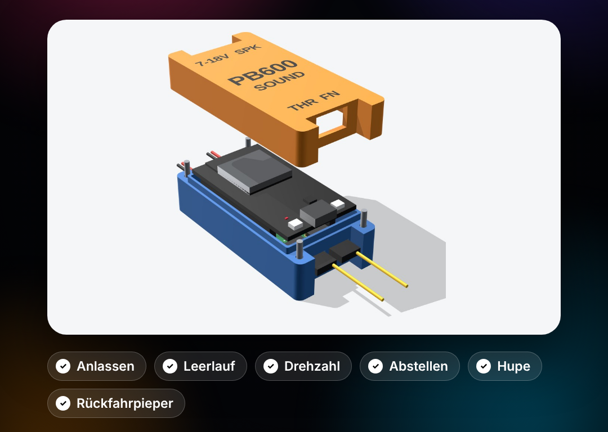
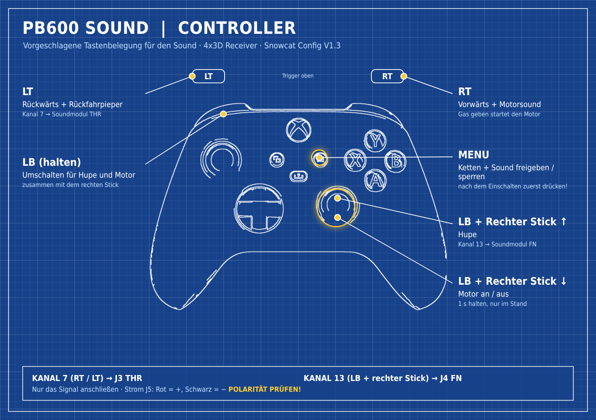

<a href="README.md">🇬🇧 English</a> &nbsp;|&nbsp; <b>🇩🇪 Deutsch</b>

# PB600 Sound

Soundmodul für den **RC PistenBully 600 im Maßstab 1:7**, gebaut für den **4x3D Universal Receiver** mit Xbox-Controller.
Eine kleine Trägerplatine wird auf ein ESP32-DevKit gesteckt und spielt Anlassen, Leerlauf, Hochdrehen, Abstellen, Hupe und Rückfahrpieper.
Lautstärken und Motorverhalten stellst du im Browser per USB ein, ohne Software.

Alles ist kostenlos für alle, die die Platine selbst bauen wollen: Platinendaten für JLCPCB, Gehäuse, Firmware und Setup-Seite.

**Schritt-für-Schritt-Anleitung:** [Deutsch](docs/ANLEITUNG.md) · [English](docs/GUIDE.md)

> [!CAUTION]
> **POLARITÄT AM STROMSTECKER (J5) PRÜFEN!** Fertige JST-PH-Kabel haben oft **Rot und Schwarz vertauscht**.
> Rot muss auf **+**, Schwarz auf **−** der Platine (Beschriftung neben J5). Vor dem Einstecken messen und bei Bedarf die Kontakte im Stecker tauschen.
> Beim ersten Modul ist genau so ein Kabel in Rauch aufgegangen.

## Eigenschaften

- Trägerplatine 28,5 × 52 mm, alle Bauteile zwischen den Stiftleisten des ESP32, bestückt von JLCPCB
- Eingang 7 bis 18 V (2S bis 4S LiPo), verpolgeschützt
- Class-D-Verstärker für einen Lautsprecher mit 4 bis 8 Ω
- 2 PWM-Eingänge: Sound-Gas (CH7) und Hupe / Motor an-aus (CH13)
- Motor dreht mit dem Gas hoch und fällt schnell ab; Rückfahrpieper nur beim Rückwärtsfahren
- Setup-Seite in Chrome / Edge: Lautstärken, Drehzahl, Hochdrehen / Abfallen, Gas-Endpunkte, Firmware-Update
- verschraubtes 3D-Druck-Gehäuse mit zweifarbiger Beschriftung

## Inhalt

| Ordner | Inhalt |
|---|---|
| [`docs/`](docs) | Schritt-für-Schritt-Anleitung (DE / EN), Controller-Spickzettel, Bilder |
| [`hardware/`](hardware) | KiCad-Projekt, Gerber, BOM und CPL für JLCPCB, Schaltplan, Datenblatt |
| [`enclosure/`](enclosure) | Gehäuse als STL, 3MF und OpenSCAD-Quelle |
| [`firmware/`](firmware) | PlatformIO-Quellcode und fertige Firmware (Version 1.7) |
| [`web-setup/`](web-setup) | Setup-Seite (Web Serial, Deutsch / Englisch) |

## Kurz

1. Platine bei JLCPCB mit den Dateien aus [`hardware/production/`](hardware/production) bestellen. **Drehung der Bauteile in der 3D-Vorschau prüfen.**
2. Gehäuse aus [`enclosure/`](enclosure) drucken.
3. ESP32 auf der **[Setup-Seite](https://oe2atn.github.io/PB600-sound/web-setup/)** flashen (Chrome / Edge, „Komplett neu“).
4. Verkabeln: J5 Strom (**Polarität!**), J6 Lautsprecher, J3 ← Empfänger CH7, J4 ← Empfänger CH13.
5. CH7 und CH13 im 4x3D-Empfänger einstellen.
6. LiPo ab → USB → auf der Setup-Seite verbinden → LiPo an → Menu drücken → Gas kalibrieren → Lautstärken → speichern.

Jeder Schritt im Detail: [docs/ANLEITUNG.md](docs/ANLEITUNG.md).

## Controller-Belegung

Vorgeschlagene Tastenbelegung für den Sound am Xbox-Controller (4x3D-Empfänger, Snowcat Config V1.3):

Englische Version: [`docs/img/PB600-Sound-Controller-EN.png`](docs/img/PB600-Sound-Controller-EN.png). Komplette Kanalbelegung des PB600 und Spickzettel: [`docs/controller/`](docs/controller).

## Benötigte Stecker

| Auf der Platine | Stecker | Anschluss |
|---|---|---|
| J5 IN 7-18V | **JST-PH 2,0 mm, 2-polig** (PHR-2) | Akku, 2S bis 4S. **Rot = +, Schwarz = −** |
| J6 SPEAKER | **JST-PH 2,0 mm, 2-polig** (PHR-2) | Lautsprecher 4 bis 8 Ω, nie an Masse |
| J3 THR | Servokabel 2,54 mm | Empfänger Kanal 7, nur Signal |
| J4 FN | Servokabel 2,54 mm | Empfänger Kanal 13, nur Signal |

## Danke und Lizenzen

- Firmware auf Basis von [Rc_Engine_Sound_ESP32](https://github.com/TheDIYGuy999/Rc_Engine_Sound_ESP32) von **TheDIYGuy999**. Bitte die Bedingungen des Originalprojekts beachten.
- PistenBully-Sounddateien: aus dem PistenBully-Soundset, öffentlich erhältlich bei **dasmikro über AliExpress** und dort bezogen.
- Flashen im Browser: [esptool-js](https://github.com/espressif/esptool-js) von Espressif, Apache 2.0.
- Hardware, Gehäuse, Setup-Seite und Dokumentation: **CC BY-NC-SA 4.0**, siehe [LICENSE.md](LICENSE.md). Nachbauen und Ändern für private Zwecke erlaubt, keine kommerzielle Nutzung.

