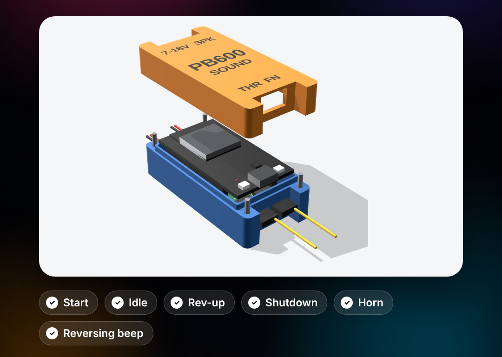
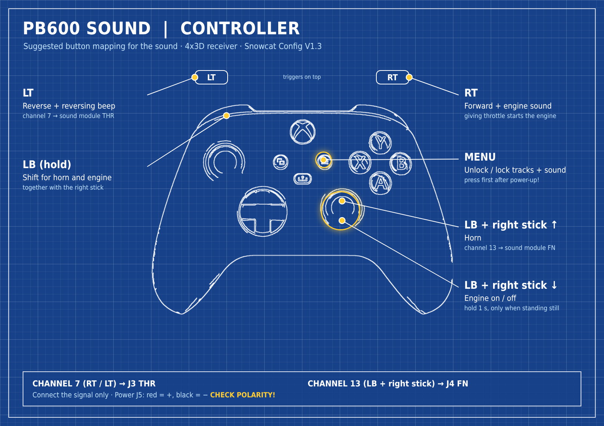

<b>🇬🇧 English</b> &nbsp;|&nbsp; <a href="README.de.md">🇩🇪 Deutsch</a>

# PB600 Sound

Engine sound module for the **1:7 RC PistenBully 600**, built for the **4x3D Universal Receiver** with Xbox controller.
A small carrier board plugs onto an ESP32 DevKit and plays start, idle, rev-up, shutdown, horn and reversing beep.
Volumes and engine behaviour are set in the browser over USB, no software needed.

Everything is free for anyone who wants to build the board themselves: PCB data for JLCPCB, enclosure, firmware and setup page.

**Step-by-step guide:** [English](docs/GUIDE.md) · [Deutsch](docs/ANLEITUNG.md)

> [!CAUTION]
> **Check the polarity of the power plug (J5)!** Ready-made JST-PH leads often have **red and black swapped**.
> Red must go to **+**, black to **−** as marked on the board. Measure before plugging in and swap the contacts in the plug if needed.
> On the first module a lead with swapped colours went up in smoke.

## Features

- carrier board 28.5 × 52 mm, all parts between the ESP32 header rows, assembled by JLCPCB
- input 7 to 18 V (2S to 4S LiPo), reverse polarity protection
- class D amplifier for a 4 to 8 Ω speaker
- 2 PWM inputs: sound throttle (CH7) and horn / engine on-off (CH13)
- engine revs with the throttle and drops back quickly; reversing beep only while reversing
- setup page in Chrome / Edge: volumes, max rpm, rev up / rev down, throttle end points, firmware update
- screwed 3D-printed enclosure with two-colour lettering

## Repository

| Folder | Content |
|---|---|
| [`docs/`](docs) | step-by-step guide (EN / DE), controller cheat sheets, pictures |
| [`hardware/`](hardware) | KiCad project, Gerber, BOM and CPL for JLCPCB, schematic, data sheet |
| [`enclosure/`](enclosure) | STL, 3MF and OpenSCAD source of the enclosure |
| [`firmware/`](firmware) | PlatformIO source and ready-made binaries (version 1.7) |
| [`web-setup/`](web-setup) | setup page (Web Serial, German / English) |

## Quick start

1. Order the board from JLCPCB with the files in [`hardware/production/`](hardware/production). **Check part rotations in the 3D preview.**
2. Print the enclosure from [`enclosure/`](enclosure).
3. Flash the ESP32 on the **[setup page](https://oe2atn.github.io/PB600-sound/web-setup/?lang=en)** (Chrome / Edge, "Full install").
4. Wire it: J5 power (**mind the polarity!**), J6 speaker, J3 ← receiver CH7, J4 ← receiver CH13.
5. Set up CH7 and CH13 in the 4x3D receiver.
6. LiPo off → USB → connect on the setup page → LiPo on → press Menu → calibrate throttle → set volumes → save.

Details for every step: [docs/GUIDE.md](docs/GUIDE.md).

## Controller mapping

Suggested button mapping for the sound on the Xbox controller (4x3D receiver, Snowcat Config V1.3):

German version: [`docs/img/PB600-Sound-Controller-DE.png`](docs/img/PB600-Sound-Controller-DE.png). Full channel map of the PB600 and cheat sheet: [`docs/controller/`](docs/controller).

## Connectors you need

| On the board | Plug | Wire to |
|---|---|---|
| J5 IN 7-18V | **JST-PH 2.0 mm, 2 pin** (PHR-2) | battery, 2S to 4S. **Red = +, black = −** |
| J6 SPEAKER | **JST-PH 2.0 mm, 2 pin** (PHR-2) | speaker 4 to 8 Ω, never to ground |
| J3 THR | servo lead 2.54 mm | receiver channel 7, signal only |
| J4 FN | servo lead 2.54 mm | receiver channel 13, signal only |

## Credits and licences

- Firmware based on [Rc_Engine_Sound_ESP32](https://github.com/TheDIYGuy999/Rc_Engine_Sound_ESP32) by **TheDIYGuy999**. Please respect the terms of the upstream project.
- PistenBully sound files: from the PistenBully sound set, publicly available from **dasmikro via AliExpress** and obtained there.
- Flashing in the browser: [esptool-js](https://github.com/espressif/esptool-js) by Espressif, Apache 2.0.
- Hardware, enclosure, setup page and documentation: **CC BY-NC-SA 4.0**, see [LICENSE.md](LICENSE.md). Free to build and modify for private use; no commercial use.

