<p align="center"><a href="GUIDE.md">🇬🇧 English</a> &nbsp;|&nbsp; <b>🇩🇪 Deutsch</b></p>

# PB600 Sound: Anleitung von der Bestellung bis zur Inbetriebnahme

Diese Anleitung führt Schritt für Schritt durch den Nachbau des Soundmoduls für den RC PistenBully 600 im Maßstab 1:7: Platine bei JLCPCB bestellen, Gehäuse drucken, ESP32 flashen, verkabeln, den 4x3D-Empfänger einstellen und den Sound im Browser abstimmen.

<p align="center">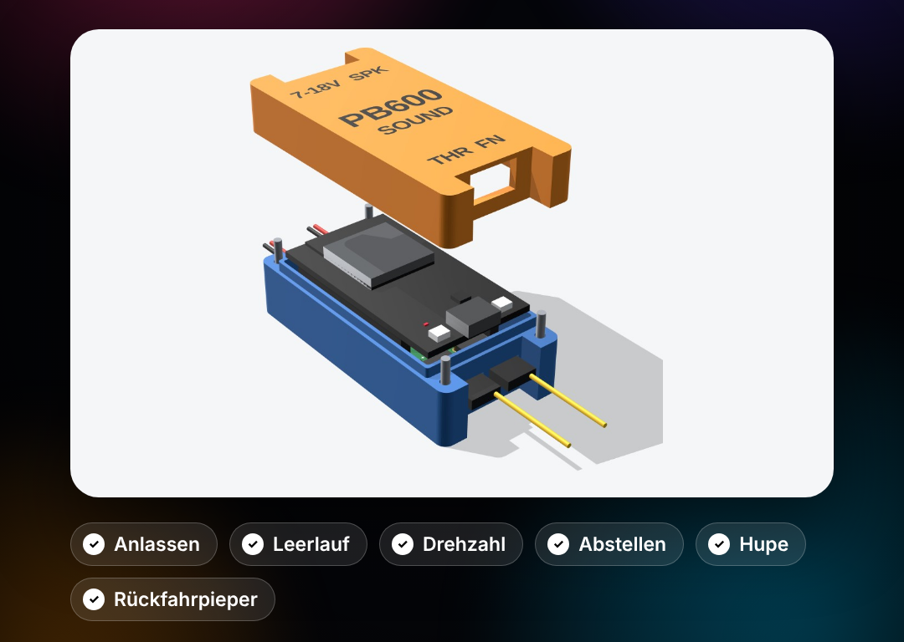</p>

> [!CAUTION]
> **POLARITÄT AM STROMEINGANG PRÜFEN!**
> Fertige JST-PH-Kabel haben oft **Rot und Schwarz vertauscht**. Beim ersten Modul ist genau so ein Kabel in Rauch aufgegangen.
> Vor dem ersten Einstecken mit dem Multimeter messen: **Rot muss auf + und Schwarz auf − der Platine** (Beschriftung neben J5).
> Passt es nicht, die beiden Kontakte im Stecker tauschen (Rasthaken mit einer Nadel anheben, Kontakt herausziehen, auf der anderen Seite wieder einrasten).

---

## Inhalt

1. [Was du brauchst](#1-was-du-brauchst)
2. [Platine bei JLCPCB bestellen](#2-platine-bei-jlcpcb-bestellen)
3. [Gehäuse drucken](#3-gehäuse-drucken)
4. [ESP32 flashen](#4-esp32-flashen)
5. [Verkabeln](#5-verkabeln)
6. [4x3D-Empfänger einstellen](#6-4x3d-empfänger-einstellen)
7. [Erster Start und Einstellungen im Browser](#7-erster-start-und-einstellungen-im-browser)
8. [Bedienung](#8-bedienung)
9. [Fehlersuche](#9-fehlersuche)
10. [Firmware selbst bauen](#10-firmware-selbst-bauen)

---

## 1. Was du brauchst

| Teil | Hinweis |
|---|---|
| PB600 Sound Carrier | bestückt von JLCPCB, Daten in [`hardware/`](../hardware) |
| ESP32-DevKit, 30 Pin | ESP-WROOM-32, 28 × 52 mm, Stiftleisten-Abstand 25,4 mm, USB-Chip CP2102 oder CH340 |
| 2 × Stecker JST-PH 2,0 mm, 2-polig | Buchsengehäuse PHR-2 mit Kabel, für **Strom (J5)** und **Lautsprecher (J6)** |
| Lautsprecher | 4 bis 8 Ω, ab ca. 2 W, z.B. 28 bis 40 mm Mini-Lautsprecher |
| Stromversorgung | 7 bis 18 V, also 2S bis 4S LiPo, z.B. vom Fahrakku abgezweigt |
| 2 × Servokabel | Buchse 2,54 mm (JR/Futaba) zum Empfänger; benutzt wird nur das Signal |
| 4 × Zylinderkopfschraube M2 × 16 | DIN 912 / ISO 4762, für das Gehäuse |
| Passendes USB-Kabel für den ESP32 | muss **Daten** übertragen, reine Ladekabel gehen nicht |
| Computer mit Chrome oder Edge | Windows, macOS, Linux oder ChromeOS; Safari, Firefox und Handys gehen nicht |
| 4x3D Universal Receiver mit Xbox-Controller | Firmware v1.31, Konfiguration Snowcat Config V1.3 |

Werkzeug: Multimeter, 3D-Drucker, Inbusschlüssel 1,5 mm.

<p align="center">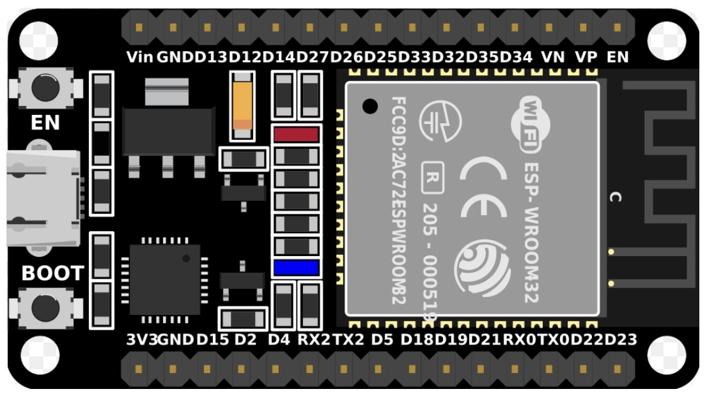 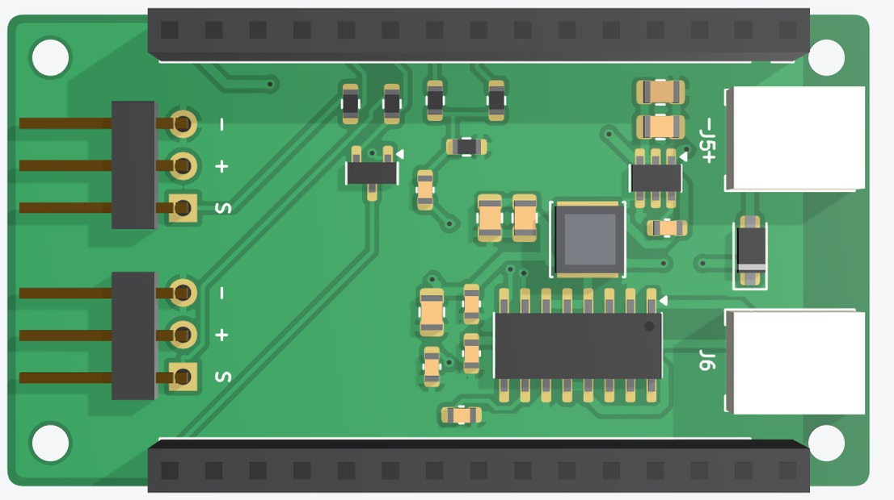</p>
<p align="center"><sub>Links das ESP32-DevKit, rechts die Trägerplatine. Die Buchsenleisten der Platine passen genau auf die Stiftleisten des ESP32.</sub></p>

## 2. Platine bei JLCPCB bestellen

Alle Fertigungsdaten liegen in [`hardware/production/`](../hardware/production):

- `PB600-Gerber.zip`: Leiterplatte
- `BOM_JLCPCB.csv`: Stückliste mit LCSC-Teilenummern
- `CPL_JLCPCB.csv`: Bestückungsplan (Lage und Drehung der Bauteile)

<p align="center">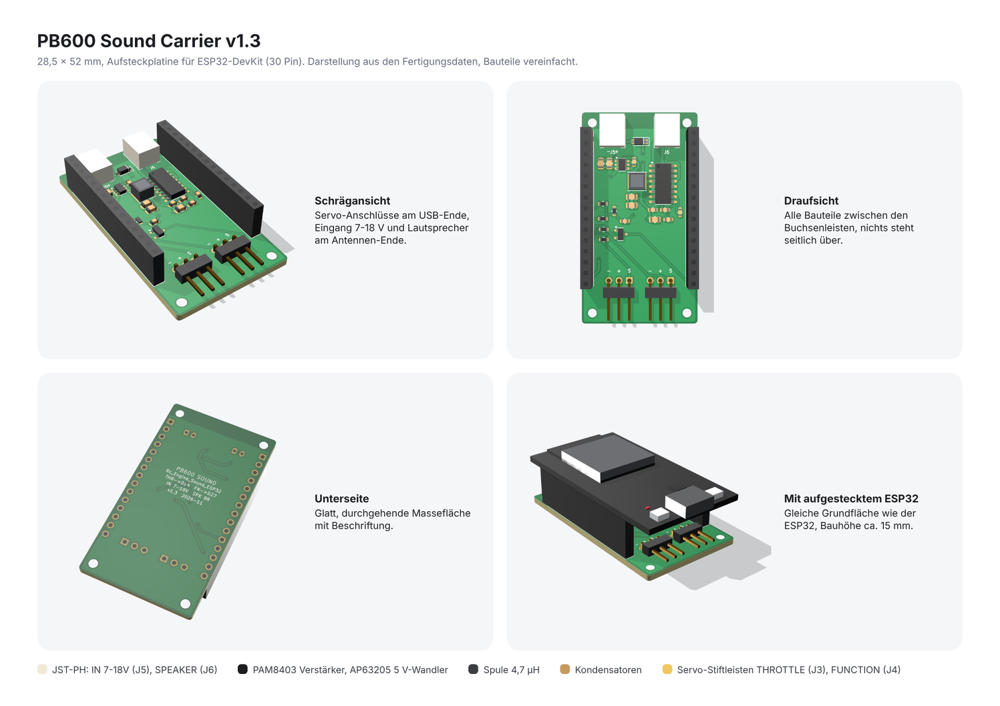</p>

### Leiterplatte

1. Auf [jlcpcb.com](https://jlcpcb.com) „Order now“ wählen und `PB600-Gerber.zip` hochladen.
2. Die Werte werden aus den Gerber-Daten übernommen. Kontrollieren:
   - 2 Lagen, 28,5 × 52 mm, FR4, 1,6 mm
   - Menge: mindestens 5 (kleinste Menge)
   - Farbe nach Wunsch; grün ist am günstigsten
3. **PCB Assembly** einschalten:
   - Seite: **Top**
   - Menge: wie viele Platinen bestückt werden sollen (mindestens 2)
   - „Tooling holes“: von JLCPCB setzen lassen

### Bestückung

4. `BOM_JLCPCB.csv` und `CPL_JLCPCB.csv` hochladen.
5. In der Teileliste prüfen, dass alle Teile gefunden und lieferbar sind. Die Buchsenleisten J1/J2, die Servo-Stiftleisten J3/J4 und die JST-Buchsen J5/J6 sind Durchsteckteile. Damit die Platine komplett fertig kommt, auch diese mitbestücken lassen.
6. **In der 3D-Vorschau die Drehung jedes Bauteils kontrollieren.** Bei der ersten Bestellung standen mehrere Teile falsch und mussten von Hand gedreht werden. Maßgeblich ist immer die Markierung im Bestückungsdruck:
   - U1 (AP63205) und U2 (PAM8403): Pin-1-Punkt am Chip muss auf dem Pin-1-Punkt der Platine liegen
   - D1 (B5819W) und D2 (BAT54C): Kathode bzw. Pin 1 wie im Bestückungsdruck
   - Kondensatoren und Widerstände sind egal, die Spule L1 auch
7. Bestellen. Fertigung und Versand dauern üblicherweise 1 bis 2 Wochen.

> [!TIP]
> Wenn du die Platine ändern willst: Das KiCad-7-Projekt liegt in [`hardware/kicad/`](../hardware/kicad).

## 3. Gehäuse drucken

Alles liegt in [`enclosure/`](../enclosure), dort steht auch eine eigene Kurzanleitung.

<p align="center">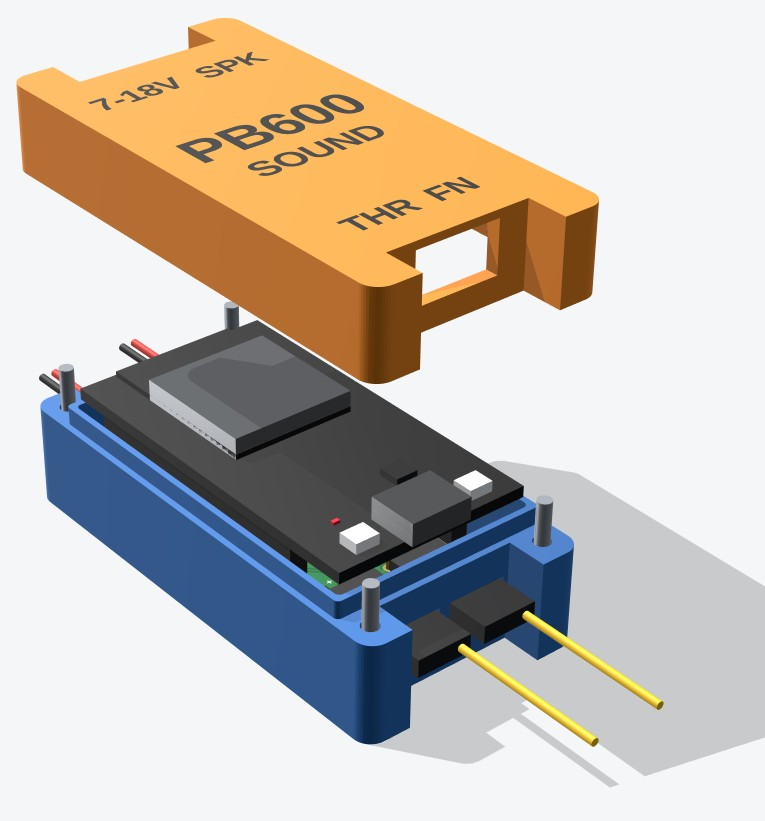</p>

- Unterteil: `PB600-Enclosure-Base.stl`, Boden nach unten
- Deckel: `PB600-Enclosure-Lid.stl`, Oberseite nach unten
- Schrift in Kontrastfarbe (vorgesehen: Schwarz): `PB600-Enclosure-Lid-2colour.3mf` öffnen und dem Teil „Schrift“ die zweite Farbe geben. Ohne AMS/MMU einfach nur den Deckel drucken, die Schrift bleibt dann vertieft sichtbar.
- PLA oder PETG, 0,2 mm Schicht, 4 Wände, 20 % Füllung, ohne Stützen
- Außenmaß 33,1 × 68,2 × 25,5 mm

Zusammenbau: ESP32 auf die Platine stecken, ins Unterteil legen, Deckel aufsetzen und mit 4 Schrauben M2 × 16 von unten verschrauben. Die Schrauben schneiden ihr Gewinde selbst, nur leicht anziehen.

## 4. ESP32 flashen

Am einfachsten über die Setup-Seite im Browser, ohne Software:

1. In **Chrome oder Edge** am Computer öffnen: **https://oe2atn.github.io/PB600-sound/web-setup/**
2. ESP32 per USB anschließen. Für das Flashen muss er nicht auf der Platine stecken.
3. Ganz unten bei „Firmware aktualisieren“ **„Komplett neu“** wählen (bei einem neuen ESP32) und „Firmware aufspielen“ klicken.
4. Im Fenster den Eintrag mit „USB“, „CP210x“ oder „usbserial“ wählen.
5. Warten, bis „Fertig“ erscheint. Hängt es bei der Verbindung: BOOT-Taste am ESP32 gedrückt halten, nochmal klicken und loslassen, sobald der Fortschritt läuft.

Für spätere Updates „Update“ wählen, dann bleiben deine Einstellungen erhalten.

<p align="center">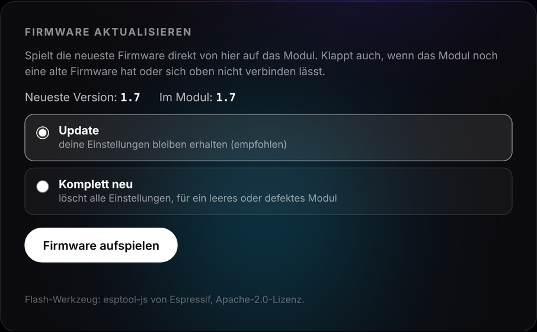</p>

**Alternative im Terminal** (mit esptool, z.B. aus PlatformIO):

```bash
# neuer ESP32, alles löschen und neu schreiben
esptool.py --chip esp32 --baud 460800 write_flash 0x0 firmware/bin/PB600-Sound-1.7-full.bin
# Update, Einstellungen bleiben
esptool.py --chip esp32 --baud 460800 write_flash 0x10000 firmware/bin/PB600-Sound-1.7-app.bin
```

## 5. Verkabeln

<p align="center"></p>
<p align="center"><sub>Links die Servo-Anschlüsse THR (J3) und FN (J4) mit S, + und −, rechts J5 (Strom) und J6 (Lautsprecher).</sub></p>

| Anschluss | Stecker | Belegung |
|---|---|---|
| J5 IN 7-18V | JST-PH 2-polig | **+ und −, Beschriftung auf der Platine beachten!** |
| J6 SPEAKER | JST-PH 2-polig | Lautsprecher, Polung egal, **nie mit Masse verbinden** |
| J3 THR | Servo 3-polig | Signal vom Empfänger, **Kanal 7** (Sound-Gas) |
| J4 FN | Servo 3-polig | Signal vom Empfänger, **Kanal 13** (Sound Hupe / Motor) |

> [!CAUTION]
> **Vor dem ersten Einstecken die Polarität von J5 messen.** Rot = +, Schwarz = −. Bei vertauschten Farben die Kontakte im Stecker tauschen.

Hinweise:

- An J3 und J4 wird **nur das Signal** gebraucht. Der Plus-Pin ist auf der Platine nicht angeschlossen. Masse ist nicht nötig, wenn Empfänger und Soundmodul am selben Akku hängen (gemeinsames Minus über den Akku). Ein Masse-Kabel schadet aber nicht.
- Die Platine versorgt den Empfänger nicht.
- Der Lautsprecher hängt an einem Brückenausgang: keiner der beiden Pole darf mit Masse oder dem Gehäuse verbunden werden.

## 6. 4x3D-Empfänger einstellen

Die Einstellungen machst du in der Weboberfläche des Empfängers (WLAN des Empfängers, dann http://192.168.4.1). Ausgangspunkt ist die Konfiguration **Snowcat Config V1.3**. Die vollständige Kanalbelegung des PB600 steht in [`docs/controller/PB600_Controller_Belegung.pdf`](controller/PB600_Controller_Belegung.pdf), der Spickzettel für die Fernbedienung in [`PB600_Cheatsheet_A6.pdf`](controller/PB600_Cheatsheet_A6.pdf).

Für das Soundmodul sind zwei Kanäle wichtig. Die vorgeschlagene Tastenbelegung:

<p align="center">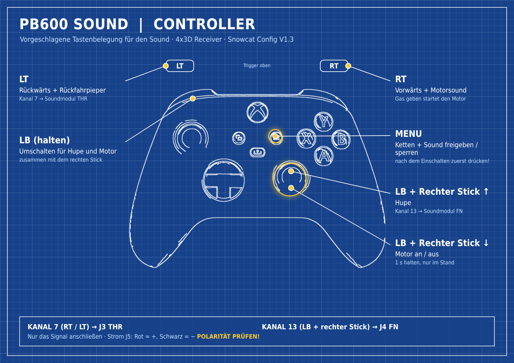</p>


| | Kanal 7: Sound-Gas | Kanal 13: Sound Hupe / Motor |
|---|---|---|
| Anschluss am Modul | J3 THR | J4 FN |
| Input type | Opposing axis (Triggers) | Proportional/direct (Joystick axis) |
| Eingabe | RT = vorwärts, LT = rückwärts | rechter Stick oben/unten (RY) |
| Shift-Taste | keine | **LB** gedrückt halten |
| Scale | 100 % | 100 % |
| Dead zone | 5 % | 20 % |
| Trim, Expo | 0 | 0 |
| Live Enable | Menu (zusammen mit den Ketten) | Menu (zusammen mit den Ketten) |

Danach **in den Flash des Empfängers speichern**.

Wichtig:

- Kanal 7 muss in Neutralstellung **1500 µs** ausgeben, ganz durchgezogen etwa 1000 bzw. 2000 µs. Die genauen Endwerte gleicht das Soundmodul beim Einrichten selbst ab (Schritt 7).
- Kanal 13 braucht keine Kalibrierung. Oben (über ca. 1900 µs) kommt die Hupe, unten (unter 1150 µs, 1 s halten) wird der Motor ein- oder ausgeschaltet.
- Nach dem Einschalten sind Ketten und Sound gesperrt. Zuerst **Menu** drücken, sonst kommt am Soundmodul kein Signal an.

## 7. Erster Start und Einstellungen im Browser

> [!IMPORTANT]
> **Reihenfolge einhalten**, sonst kommt keine USB-Verbindung zustande:
> 1. Modell aus, LiPo **nicht** angesteckt.
> 2. ESP32 per USB an den Computer.
> 3. In Chrome oder Edge **https://oe2atn.github.io/PB600-sound/web-setup/** öffnen, „Verbinden“ klicken, Eintrag wählen, warten bis „verbunden“ erscheint.
> 4. **Erst jetzt** den LiPo anstecken.

<p align="center">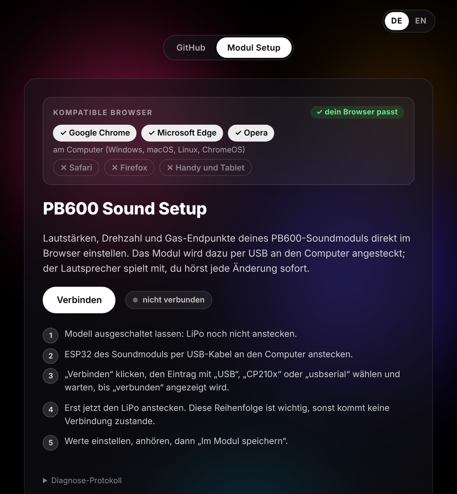</p>

Nach dem Verbinden steht oben „verbunden · Firmware 1.7“ und darunter „Verbunden. Jetzt den LiPo anstecken.“:

<p align="center">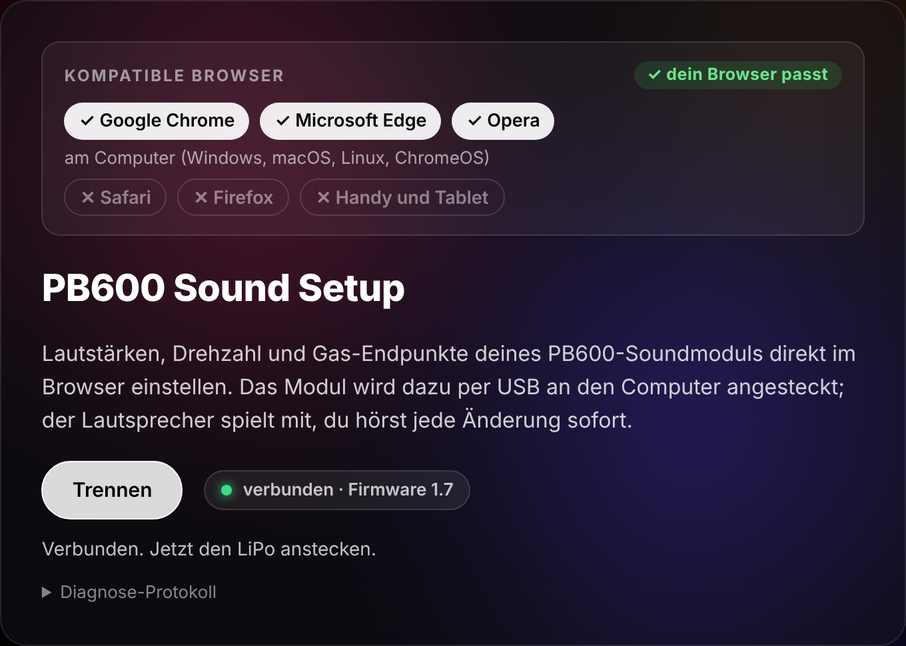</p>

Dann:

1. Am Controller **Menu** drücken, damit Ketten und Sound freigegeben sind. Unter „Live vom Empfänger“ bewegen sich jetzt die Balken.

<p align="center">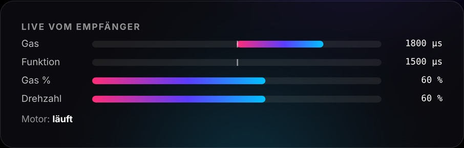</p>
2. **Gas-Endpunkte kalibrieren:** RT ganz durchziehen und halten, bei „Vollgas vorwärts“ auf „Übernehmen“ klicken. Dann LT ganz durchziehen und halten, bei „Vollgas rückwärts“ auf „Übernehmen“ klicken. Damit dreht der Motor vorwärts und rückwärts gleich hoch und gleich laut.

<p align="center">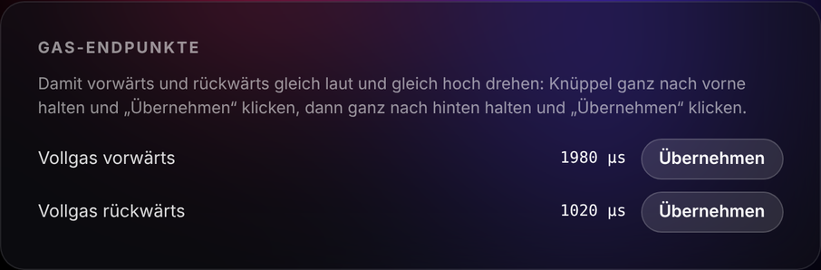</p>
3. **Lautstärken einstellen:** Gesamt, Leerlauf, Vollgas, Anlassen, Abstellen, Hupe, Rückfahrpieper. Jede Änderung ist sofort zu hören.
4. **Motor einstellen:** höchste Drehzahl (100 % = Tonhöhe bleibt gleich, 130 % ist der Standard), wie schnell er hochdreht und wieder abfällt.

<p align="center">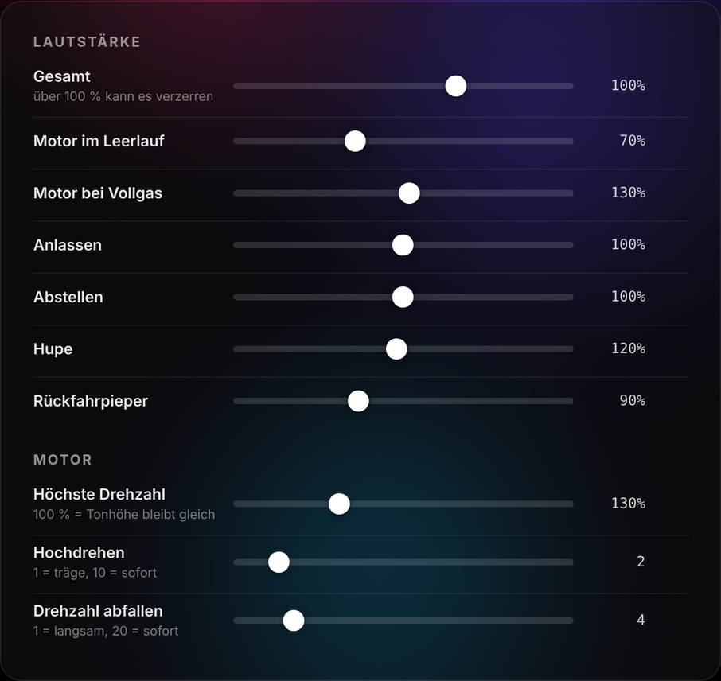</p>
5. **„Im Modul speichern“** klicken. Erst dann bleiben die Werte nach dem Ausschalten erhalten.

<p align="center">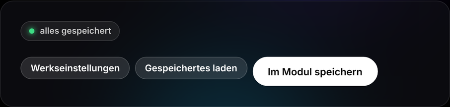</p>

„Gespeichertes laden“ holt die zuletzt gespeicherten Werte zurück, „Werkseinstellungen“ setzt alles auf die Standardwerte (danach auch speichern).

Klappt etwas nicht: Unter dem Verbinden-Knopf „Diagnose-Protokoll“ aufklappen. Dort steht alles, was das Modul sendet.

## 8. Bedienung

Zum Ausdrucken: [`img/PB600-Sound-Controller-DE.png`](img/PB600-Sound-Controller-DE.png)

| Am Controller | Wirkung |
|---|---|
| Menu | Ketten und Sound freigeben / sperren (nach dem Einschalten gesperrt) |
| RT | vorwärts, Motor dreht hoch; **Gas geben startet den Motor** |
| LT | rückwärts, Motor dreht hoch, **Rückfahrpieper** solange LT gedrückt ist |
| LB + rechter Stick hoch | Hupe |
| LB + rechter Stick runter, 1 s halten | Motor an / aus (nur im Stand) |

Beim Loslassen von RT oder LT fällt die Drehzahl schnell auf Leerlauf zurück, der Pieper hört sofort auf.

## 9. Fehlersuche

| Problem | Lösung |
|---|---|
| Keine USB-Verbindung, „Keine Antwort vom Modul“ | LiPo ab, USB ab- und wieder anstecken, verbinden, **dann** LiPo. Datenfähiges USB-Kabel verwenden. |
| ESP32 erscheint nicht in der Auswahl | USB-Treiber für CP2102 bzw. CH340 installieren; anderes Kabel probieren. |
| Seite meldet „Dieser Browser kann es nicht“ | Chrome oder Edge am Computer verwenden. |
| Im Protokoll steht „Invalid command!“ | Alte Firmware. Unten auf der Setup-Seite „Update“ aufspielen. |
| Kein Ton, Balken bewegen sich nicht | Menu am Controller drücken; Kanal 7 an J3? Signalkabel richtig herum (S = Signal)? |
| Kein Ton, Balken bewegen sich | Motor mit LB + Stick runter (1 s) oder Gas starten; Lautstärke „Gesamt“ prüfen; Lautsprecher an J6? |
| Rückwärts lauter als vorwärts | Gas-Endpunkte kalibrieren (Schritt 7). |
| Ticken im Takt der ESP-LED | Nur bei sehr alter Firmware; aktuelle Firmware aufspielen. |
| Kabel oder Stecker wird heiß / raucht | **Sofort abstecken.** Polarität an J5 prüfen (siehe oben). |

## 10. Firmware selbst bauen

Der Quellcode liegt in [`firmware/`](../firmware). Er basiert auf [Rc_Engine_Sound_ESP32](https://github.com/TheDIYGuy999/Rc_Engine_Sound_ESP32) von TheDIYGuy999 (Version 9.15.0-b8), angepasst für den PB600.

```bash
cd firmware
pio run                     # bauen
pio run -t upload           # auf den angeschlossenen ESP32 spielen
```

- PlatformIO mit `espressif32@6.10.0`. Neuere Plattform-Versionen kompilieren nicht.
- Fahrzeugprofil: `src/vehicles/PistenBully600.h`, Empfängerprofil `PB600_XBOX` in `src/2_Remote.h`.
- Die USB-Einstellungen (Setup-Seite) stecken in `src/src/pb600Config.h`.
- Details zu allen Änderungen: [`firmware/README.md`](../firmware/README.md).
