<p align="center"><b>🇬🇧 English</b> &nbsp;|&nbsp; <a href="ANLEITUNG.md">🇩🇪 Deutsch</a></p>

# PB600 Sound: from ordering to first start

This guide walks you through building the engine sound module for the 1:7 RC PistenBully 600: ordering the board from JLCPCB, printing the enclosure, flashing the ESP32, wiring, setting up the 4x3D receiver and tuning the sound in the browser.

<p align="center">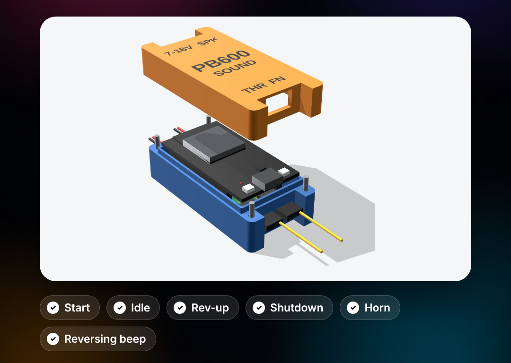</p>

> [!CAUTION]
> **CHECK THE POLARITY OF THE POWER INPUT!**
> Ready-made JST-PH cables often have **red and black swapped**. On the first module exactly such a cable went up in smoke.
> Before plugging in for the first time, measure with a multimeter: **red must go to + and black to − on the board** (marking next to J5).
> If it does not match, swap the two contacts in the plug (lift the latch with a needle, pull the contact out, click it in on the other side).

---

## Contents

1. [What you need](#1-what-you-need)
2. [Ordering the board from JLCPCB](#2-ordering-the-board-from-jlcpcb)
3. [Printing the enclosure](#3-printing-the-enclosure)
4. [Flashing the ESP32](#4-flashing-the-esp32)
5. [Wiring](#5-wiring)
6. [Setting up the 4x3D receiver](#6-setting-up-the-4x3d-receiver)
7. [First start and settings in the browser](#7-first-start-and-settings-in-the-browser)
8. [Operation](#8-operation)
9. [Troubleshooting](#9-troubleshooting)
10. [Building the firmware yourself](#10-building-the-firmware-yourself)

---

## 1. What you need

| Part | Note |
|---|---|
| PB600 Sound Carrier | assembled by JLCPCB, data in [`hardware/`](../hardware) |
| ESP32 DevKit, 30 pin | ESP-WROOM-32, 28 × 52 mm, header row spacing 25.4 mm, USB chip CP2102 or CH340 |
| 2 × JST-PH 2.0 mm plug, 2 pin | PHR-2 housing with wires, for **power (J5)** and **speaker (J6)** |
| Speaker | 4 to 8 Ω, 2 W or more, e.g. a 28 to 40 mm mini speaker |
| Power | 7 to 18 V, i.e. 2S to 4S LiPo, e.g. branched off the drive battery |
| 2 × servo lead | 2.54 mm female (JR/Futaba) to the receiver; only the signal is used |
| 4 × socket head screw M2 × 16 | DIN 912 / ISO 4762, for the enclosure |
| Micro USB cable | must carry **data**, charge-only cables do not work |
| Computer with Chrome or Edge | Windows, macOS, Linux or ChromeOS; Safari, Firefox and phones do not work |
| 4x3D Universal Receiver with Xbox controller | firmware v1.31, configuration Snowcat Config V1.3 |

Tools: multimeter, 3D printer, 1.5 mm hex key.

<p align="center">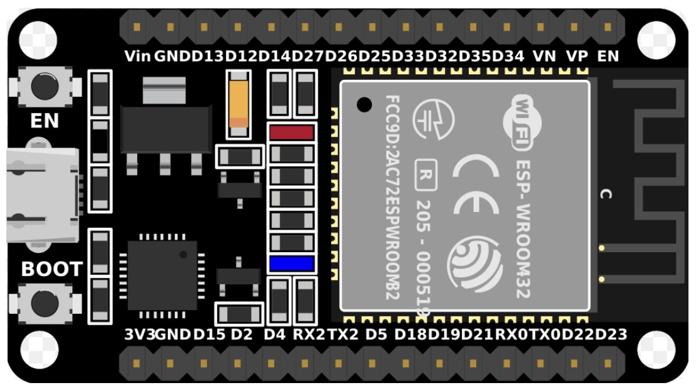 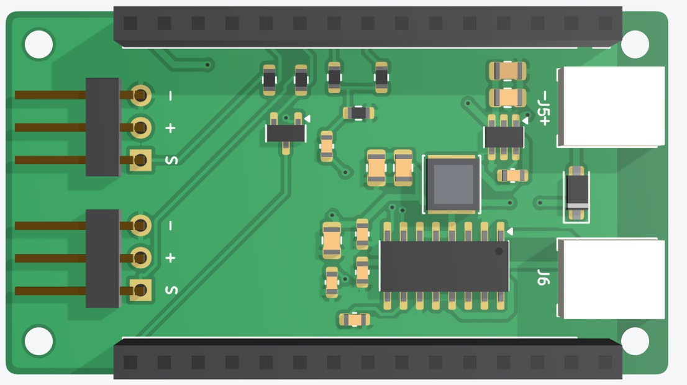</p>
<p align="center"><sub>Left the ESP32 DevKit, right the carrier board. The board's female headers match the ESP32 pin rows exactly.</sub></p>

## 2. Ordering the board from JLCPCB

All manufacturing data is in [`hardware/production/`](../hardware/production):

- `PB600-Gerber.zip`: the PCB
- `BOM_JLCPCB.csv`: bill of materials with LCSC part numbers
- `CPL_JLCPCB.csv`: pick-and-place file (position and rotation of the parts)

<p align="center">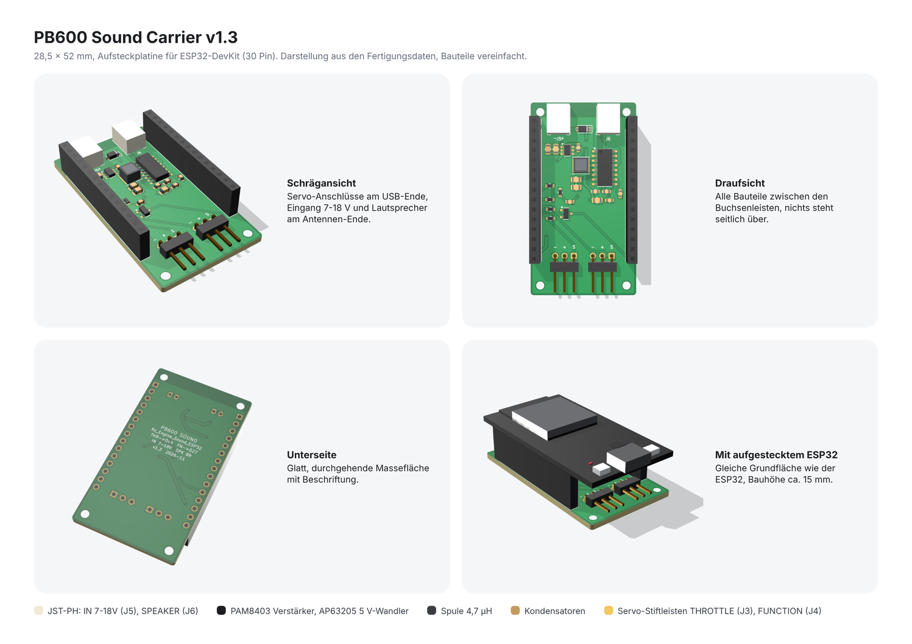</p>

### PCB

1. On [jlcpcb.com](https://jlcpcb.com) choose "Order now" and upload `PB600-Gerber.zip`.
2. The settings are taken from the Gerber data. Check:
   - 2 layers, 28.5 × 52 mm, FR4, 1.6 mm
   - quantity: at least 5 (minimum)
   - colour as you like; green is the cheapest
3. Switch on **PCB Assembly**:
   - side: **Top**
   - quantity: how many boards to assemble (at least 2)
   - tooling holes: added by JLCPCB

### Assembly

4. Upload `BOM_JLCPCB.csv` and `CPL_JLCPCB.csv`.
5. Check that all parts are found and in stock. The female headers J1/J2, the servo headers J3/J4 and the JST sockets J5/J6 are through-hole parts. To get a finished board, have them assembled too.
6. **Check the rotation of every part in the 3D preview.** On the first order several parts were rotated wrongly and had to be turned by hand. Always go by the marking on the silkscreen:
   - U1 (AP63205) and U2 (PAM8403): pin-1 dot of the chip on the pin-1 dot of the board
   - D1 (B5819W) and D2 (BAT54C): cathode or pin 1 as on the silkscreen
   - capacitors, resistors and the inductor L1 do not matter
7. Order. Production and shipping usually take 1 to 2 weeks.

> [!TIP]
> To change the board: the KiCad 7 project is in [`hardware/kicad/`](../hardware/kicad).

## 3. Printing the enclosure

Everything is in [`enclosure/`](../enclosure), which has its own short guide.

<p align="center">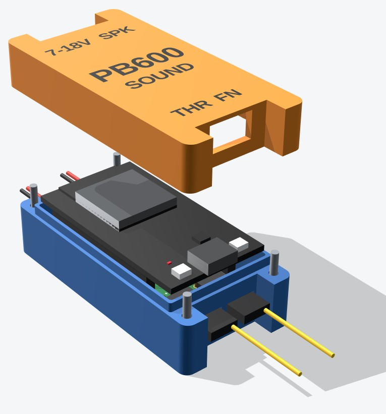</p>

- base: `PB600-Enclosure-Base.stl`, floor down
- lid: `PB600-Enclosure-Lid.stl`, top face down
- lettering in a contrasting colour (intended: black): open `PB600-Enclosure-Lid-2colour.3mf` and give the part "Schrift" the second colour. Without AMS/MMU just print the lid; the lettering stays visible as a recess.
- PLA or PETG, 0.2 mm layers, 4 walls, 20 % infill, no supports
- outside dimensions 33.1 × 68.2 × 25.5 mm

Assembly: plug the ESP32 onto the board, place it in the base, put on the lid and fix it with 4 M2 × 16 screws from below. The screws cut their own thread; tighten gently.

## 4. Flashing the ESP32

The easiest way is the setup page in the browser, no software needed:

1. Open in **Chrome or Edge** on a computer: **https://oe2atn.github.io/PB600-sound/web-setup/?lang=en**
2. Connect the ESP32 via USB. It does not need to sit on the board for flashing.
3. At the bottom under "Update firmware" choose **"Full install"** (for a new ESP32) and click "Install firmware".
4. In the dialog pick the entry with "USB", "CP210x" or "usbserial".
5. Wait for "Done". If it hangs while connecting: hold the BOOT button on the ESP32, click again and release as soon as progress starts.

For later updates choose "Update"; your settings are kept.

<p align="center">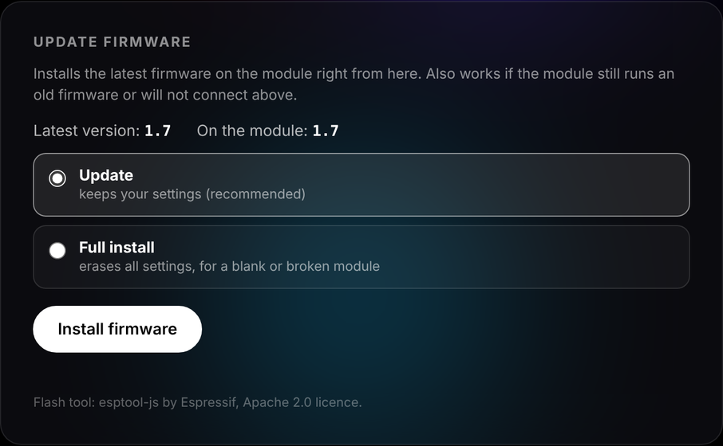</p>

**Alternative in a terminal** (with esptool, e.g. from PlatformIO):

```bash
# new ESP32, erase and write everything
esptool.py --chip esp32 --baud 460800 write_flash 0x0 firmware/bin/PB600-Sound-1.7-full.bin
# update, settings are kept
esptool.py --chip esp32 --baud 460800 write_flash 0x10000 firmware/bin/PB600-Sound-1.7-app.bin
```

## 5. Wiring

<p align="center"></p>
<p align="center"><sub>Left the servo inputs THR (J3) and FN (J4) with S, + and −, right J5 (power) and J6 (speaker).</sub></p>

| Connector | Plug | Pinout |
|---|---|---|
| J5 IN 7-18V | JST-PH 2 pin | **+ and −, follow the marking on the board!** |
| J6 SPEAKER | JST-PH 2 pin | speaker, polarity does not matter, **never connect to ground** |
| J3 THR | servo 3 pin | signal from the receiver, **channel 7** (sound throttle) |
| J4 FN | servo 3 pin | signal from the receiver, **channel 13** (sound horn / engine) |

> [!CAUTION]
> **Measure the polarity of J5 before plugging in for the first time.** Red = +, black = −. If the colours are swapped, swap the contacts in the plug.

Notes:

- J3 and J4 only need the **signal**. The plus pin is not connected on the board. Ground is not needed when receiver and sound module run from the same battery (common minus through the battery). A ground wire does no harm, though.
- The board does not power the receiver.
- The speaker sits on a bridged output: neither pole may be connected to ground or the chassis.

## 6. Setting up the 4x3D receiver

Settings are made in the receiver's web interface (join the receiver's Wi-Fi, then open http://192.168.4.1). The starting point is the configuration **Snowcat Config V1.3**. The full PB600 channel map is in [`docs/controller/PB600_Controller_Belegung.pdf`](controller/PB600_Controller_Belegung.pdf), the cheat sheet for the controller in [`PB600_Cheatsheet_A6.pdf`](controller/PB600_Cheatsheet_A6.pdf) (both German).

Two channels matter for the sound module. The suggested button mapping:

<p align="center">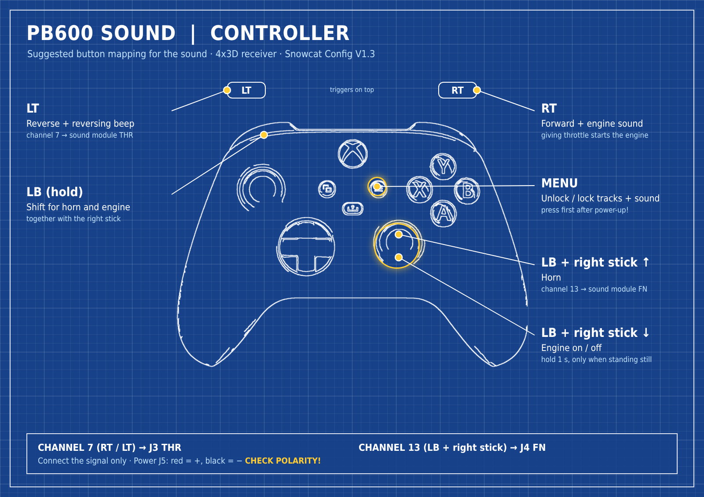</p>


| | Channel 7: sound throttle | Channel 13: sound horn / engine |
|---|---|---|
| Module input | J3 THR | J4 FN |
| Input type | Opposing axis (Triggers) | Proportional/direct (Joystick axis) |
| Input | RT = forward, LT = reverse | right stick up/down (RY) |
| Shift button | none | hold **LB** |
| Scale | 100 % | 100 % |
| Dead zone | 5 % | 20 % |
| Trim, expo | 0 | 0 |
| Live enable | Menu (together with the tracks) | Menu (together with the tracks) |

Then **save to the receiver flash**.

Important:

- Channel 7 must output **1500 µs** at neutral and about 1000 / 2000 µs fully pulled. The module matches the exact end points itself during setup (step 7).
- Channel 13 needs no calibration. Up (above about 1900 µs) sounds the horn, down (below 1150 µs, hold 1 s) switches the engine on or off.
- After power-up the tracks and sound are locked. Press **Menu** first, otherwise no signal reaches the sound module.

## 7. First start and settings in the browser

> [!IMPORTANT]
> **Keep this order**, otherwise the USB connection will not work:
> 1. Model off, LiPo **not** plugged in.
> 2. ESP32 to the computer via USB.
> 3. Open **https://oe2atn.github.io/PB600-sound/web-setup/?lang=en** in Chrome or Edge, click "Connect", pick the entry, wait for "connected".
> 4. **Only now** plug in the LiPo.

<p align="center">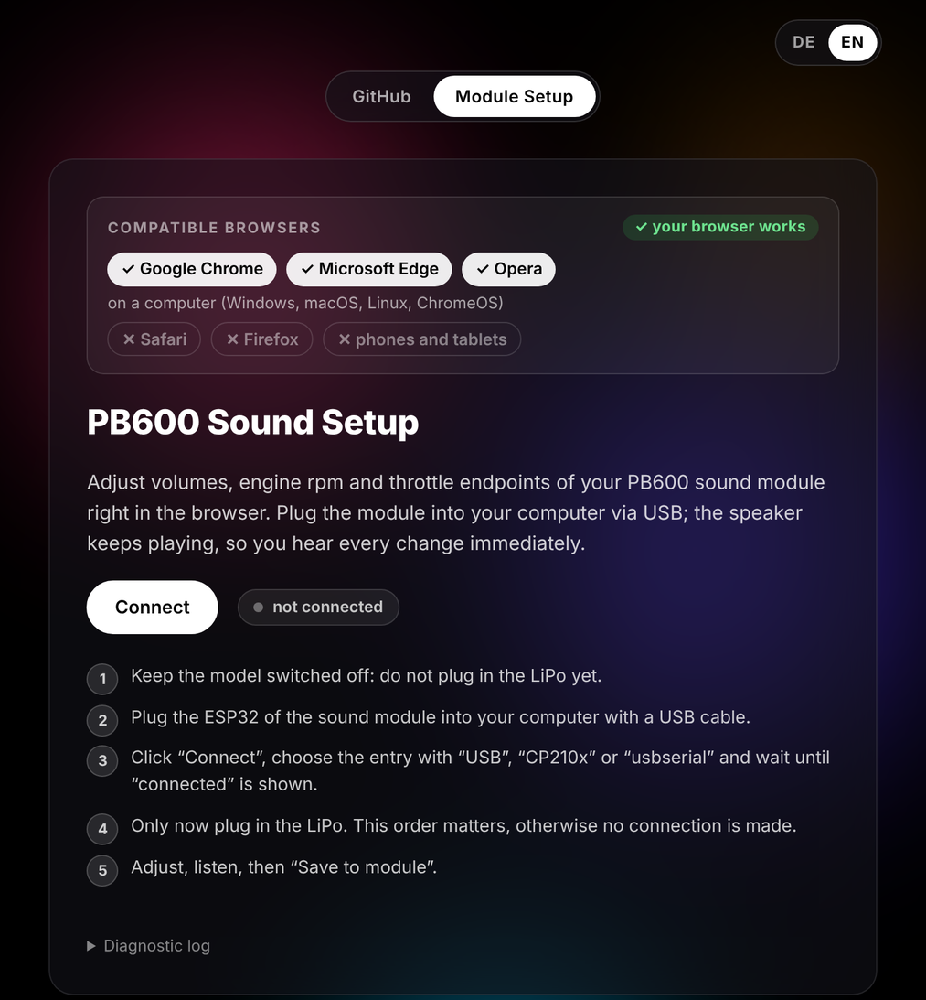</p>

Once connected, the top shows "connected · Firmware 1.7" and below "Connected. Now plug in the LiPo.":

<p align="center">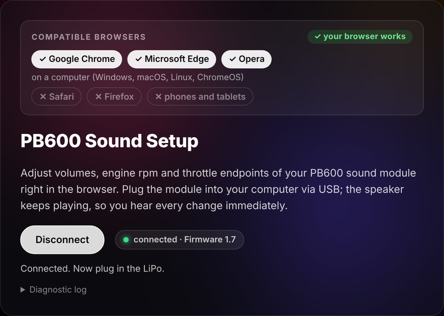</p>

Then:

1. Press **Menu** on the controller to unlock tracks and sound. The bars under "Live from the receiver" now move.

<p align="center">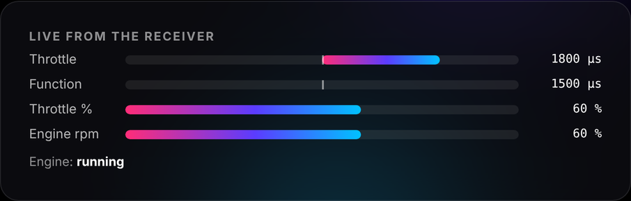</p>
2. **Calibrate the throttle end points:** pull RT fully and hold, click "Take" next to "Full throttle forward". Then pull LT fully and hold, click "Take" next to "Full throttle reverse". Forward and reverse now rev equally high and sound equally loud.

<p align="center">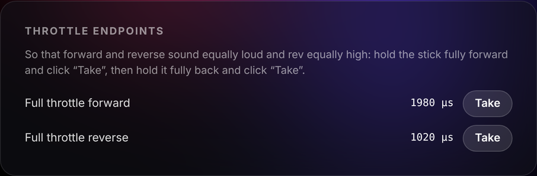</p>
3. **Set the volumes:** master, idle, full throttle, start, shutdown, horn, reversing beep. Every change can be heard right away.
4. **Set up the engine:** maximum rpm (100 % = pitch stays the same, default 130 %), how quickly it revs up and drops back.

<p align="center">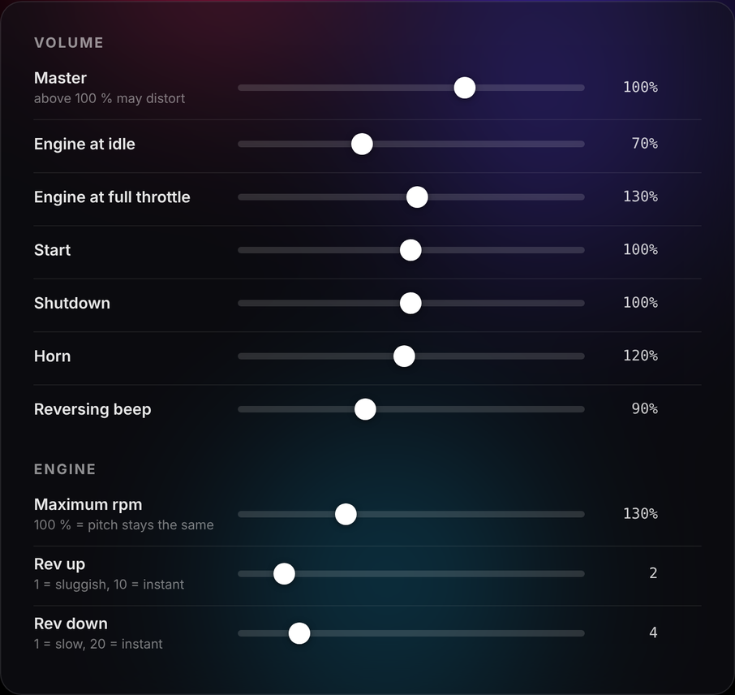</p>
5. Click **"Save to module"**. Only then are the values kept after power-off.

<p align="center"></p>

"Load saved" brings back the last saved values, "Factory settings" resets everything to defaults (save afterwards as well).

If something does not work: open "Diagnostic log" below the Connect button. It shows everything the module sends.

## 8. Operation

To print: [`img/PB600-Sound-Controller-EN.png`](img/PB600-Sound-Controller-EN.png)

| On the controller | Effect |
|---|---|
| Menu | unlock / lock tracks and sound (locked after power-up) |
| RT | forward, engine revs up; **giving throttle starts the engine** |
| LT | reverse, engine revs up, **reversing beep** while LT is held |
| LB + right stick up | horn |
| LB + right stick down, hold 1 s | engine on / off (only when standing still) |

When RT or LT is released, the rpm drops back to idle quickly and the beep stops at once.

## 9. Troubleshooting

| Problem | Solution |
|---|---|
| No USB connection, "No answer from the module" | LiPo off, unplug and replug USB, connect, **then** LiPo. Use a data USB cable. |
| ESP32 does not show up in the list | install the USB driver for CP2102 or CH340; try another cable. |
| Page says "your browser cannot do this" | use Chrome or Edge on a computer. |
| Log shows "Invalid command!" | old firmware. Install "Update" at the bottom of the setup page. |
| No sound, bars do not move | press Menu on the controller; channel 7 on J3? Signal lead the right way round (S = signal)? |
| No sound, bars move | start the engine with LB + stick down (1 s) or throttle; check master volume; speaker on J6? |
| Reverse louder than forward | calibrate the throttle end points (step 7). |
| Ticking in time with the ESP LED | only with very old firmware; install the current firmware. |
| Cable or plug gets hot / smokes | **unplug at once.** Check the polarity at J5 (see above). |

## 10. Building the firmware yourself

The source code is in [`firmware/`](../firmware). It is based on [Rc_Engine_Sound_ESP32](https://github.com/TheDIYGuy999/Rc_Engine_Sound_ESP32) by TheDIYGuy999 (version 9.15.0-b8), adapted for the PB600.

```bash
cd firmware
pio run                     # build
pio run -t upload           # flash the connected ESP32
```

- PlatformIO with `espressif32@6.10.0`. Newer platform versions do not compile.
- Vehicle profile: `src/vehicles/PistenBully600.h`, receiver profile `PB600_XBOX` in `src/2_Remote.h`.
- The USB settings (setup page) live in `src/src/pb600Config.h`.
- All changes in detail: [`firmware/README.md`](../firmware/README.md).
